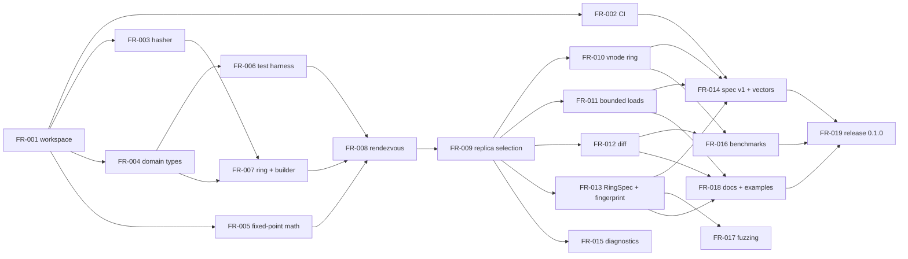

# FleetRing tickets

Local tickets for the `fleetring` ring and placement crate, which is MVP step 1 in [`docs/mvp.md`](../mvp.md). Design decisions are recorded in [`docs/adr/`](../adr/README.md), and tickets link to the ADRs they implement.

## Conventions

- **One file per ticket**, named `FR-NNN-short-slug.md`. Each file starts with YAML front matter:
  - `status`: `todo`, `in-progress`, `blocked`, or `done`
  - `priority`: `P0` blocks `fleetringd` work, `P1` is required for 0.1.0, `P2` may slip past 0.1.0
  - `size`: `S` is half a day or less, `M` is 1–2 days, `L` is 3–4 days
  - `depends_on`: the IDs of prerequisite tickets
  - `adrs`: the ADRs the ticket implements
- **Commits** follow Conventional Commits, using the crate area as the scope (`feat(ring): …`) and a `Refs: FR-NNN` trailer.
- **Done** means every acceptance criterion is checked, CI is green, and the definition of done below holds.

## Definition of done

These items follow the Rust API Guidelines and common Rust best practices.

- `cargo fmt`, `cargo clippy --all-targets --all-features -- -D warnings`, `cargo test`, and `cargo doc --no-deps` (with `-D warnings`) are all clean.
- No `unwrap()` outside tests. Every `expect`, `assert`, and `panic` message includes the relevant values.
- Every public item is documented. The first line is a one-sentence summary, the examples use `?`, and `# Errors` and `# Panics` sections appear where relevant.
- Public types derive `Debug` and the applicable common traits. Error types implement `Error + Display + Send + Sync + 'static`.
- Public signatures have no `bool` parameters, no `&String` or `&Vec<T>`, and no third-party types.
- No floats, `std::hash`, `HashMap`, or `HashSet` appear in placement code (ADR-0002, ADR-0003).
- New placement behavior is covered by property tests and, from FR-014 on, by golden vectors.

## Milestones

| Milestone | Tickets | Outcome |
|---|---|---|
| M0 Foundations | FR-001, FR-002 | The workspace and CI enforce ADR-0009 on every platform where determinism usually breaks |
| M1 Hashing and model | FR-003 – FR-006 | Stable hasher, domain types, fixed-point math, and a deterministic test harness |
| M2 Placement core | FR-007 – FR-011 | Ring, rendezvous, topology-aware replica sets, vnode ring, and bounded loads |
| M3 Change and interop | FR-012 – FR-015 | Diff, `RingSpec` and fingerprint, spec v1 with golden vectors, and diagnostics |
| M4 Hardening and release | FR-016 – FR-019 | Benchmarks, fuzzing, docs, and the 0.1.0 release with the spec frozen |

## Index

| ID | Title | P | Size | Depends on | Status |
|---|---|---|---|---|---|
| [FR-001](FR-001-workspace-hygiene.md) | Workspace hygiene: edition 2024, MSRV, lints, licenses | P0 | S | — | done |
| [FR-002](FR-002-ci-pipeline.md) | CI pipeline across the platforms where determinism breaks | P0 | M | FR-001 | in-progress |
| [FR-003](FR-003-stable-hasher.md) | `StableHasher` trait and the default `Xxh3` hasher | P0 | S | FR-001 | done |
| [FR-004](FR-004-domain-types.md) | Domain types: `NodeId`, `Zone`, `Host`, `Weight`, `ReplicationFactor`, `Node`, `Epoch` | P0 | M | FR-001 | done |
| [FR-005](FR-005-fixed-point-math.md) | Fixed-point −log₂ and exact score comparison | P0 | M | FR-001 | done |
| [FR-006](FR-006-test-harness.md) | Deterministic test harness, key corpora, balance statistics | P0 | S | FR-004 | done |
| [FR-007](FR-007-ring-builder.md) | `Ring` and `RingBuilder` with validation and canonical membership | P0 | M | FR-003, FR-004 | todo |
| [FR-008](FR-008-rendezvous-strategy.md) | Weighted rendezvous candidate order (default strategy) | P0 | M | FR-005, FR-006, FR-007 | todo |
| [FR-009](FR-009-replica-selection.md) | Topology-aware replica selection, `ReplicaSet`, preference lists | P0 | L | FR-008 | todo |
| [FR-010](FR-010-vnode-strategy.md) | Weighted virtual-node ring strategy | P1 | M | FR-009 | todo |
| [FR-011](FR-011-bounded-loads.md) | Bounded-load placement policy | P1 | M | FR-009 | todo |
| [FR-012](FR-012-ring-diff.md) | Ring diff and movement summary for migration planning | P1 | M | FR-009 | todo |
| [FR-013](FR-013-ring-spec-fingerprint.md) | `RingSpec`, canonical encoding, fingerprint, serde support | P0 | M | FR-009 | todo |
| [FR-014](FR-014-placement-spec-vectors.md) | Placement spec v1, golden vectors, independent reference check | P1 | L | FR-002, FR-010, FR-011, FR-013 | todo |
| [FR-015](FR-015-diagnostics.md) | Ring diagnostics and expected load shares | P2 | S | FR-009 | todo |
| [FR-016](FR-016-benchmarks.md) | Benchmarks and performance budget | P1 | S | FR-010, FR-012 | todo |
| [FR-017](FR-017-fuzzing.md) | Fuzzing for spec decoding, builder input, lookup invariants | P2 | S | FR-013 | todo |
| [FR-018](FR-018-docs-examples.md) | Crate documentation, examples, README accuracy | P1 | M | FR-011, FR-012, FR-013 | todo |
| [FR-019](FR-019-release-0-1-0.md) | Release `fleetring` 0.1.0 and freeze placement spec v1 | P1 | S | FR-014, FR-016, FR-018 | todo |

## Dependency graph

## Critical path and estimate

The critical path is: FR-001 → FR-003 / FR-004 / FR-005 (parallel) → FR-007 → FR-008 → FR-009 → FR-010 → FR-014 → FR-019.

| Scope | Tickets | Estimate (one engineer) |
|---|---|---|
| P0: unblocks `fleetringd` | 10 tickets | ≈ 14 engineer-days |
| P0 + P1: the 0.1.0 release | 17 tickets | ≈ 25 engineer-days |
| Everything, including P2 | 19 tickets | ≈ 26 engineer-days |

`docs/mvp.md` allows 4–6 weeks for all eight MVP steps, with the ring crate as step 1. At about three weeks, P0 alone takes more than a proportional share. If the timeline is fixed, start `fleetringd` once P0 is done and run P1 in parallel. P2 can slip past 0.1.0 without affecting placement.

## Backlog (not yet ticketed)

- **Placement pools and residency** (key prefix → pool → ring) for EU/US tenants and sovereign deployments. This needs its own ADR first.
- **Hierarchical rendezvous** for fleets beyond about 1000 nodes. This would be spec v2, and only if FR-016 shows it's needed.
- **Keyed hasher** (SipHash-1-3 with a secret key) for adversarial key spaces.
- **`no_std + alloc`** support. The `std` feature is already reserved.
- **WASM bindings and the ring playground**, plus TypeScript and Python conformance kits built from the vectors.
- **Client-side override cache**: home placement plus redirects, with a cache of actual placements.
- **Load-aware rebalance planner** for hot-spot moves in `fleetringd` v0.2.
